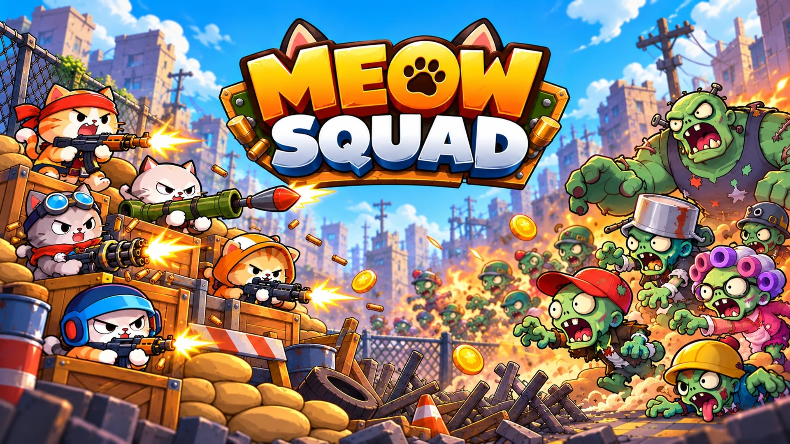
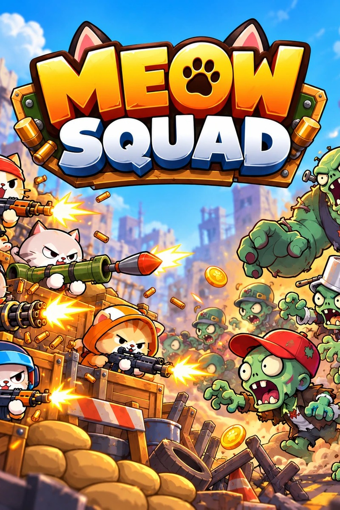
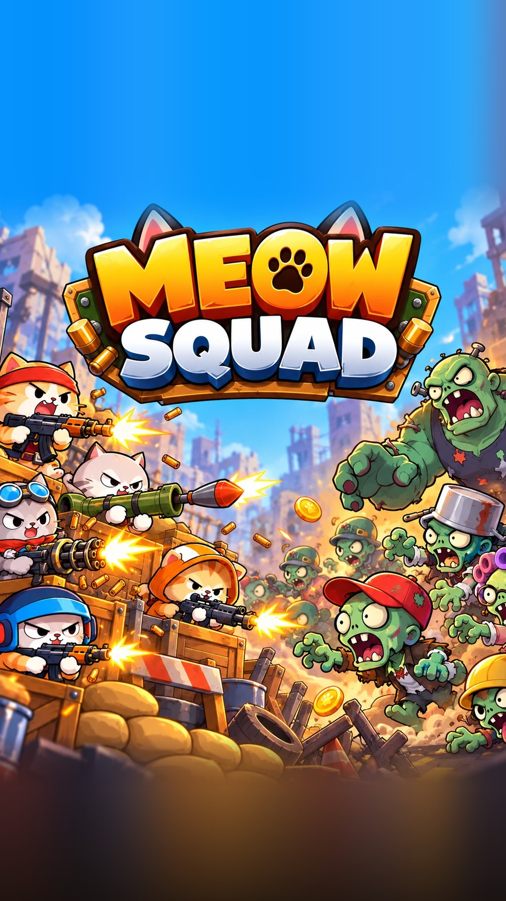
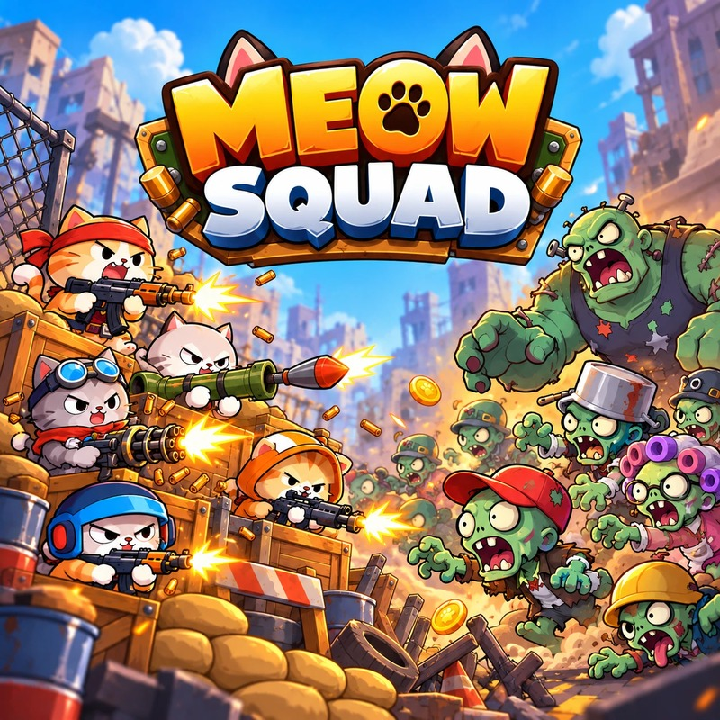
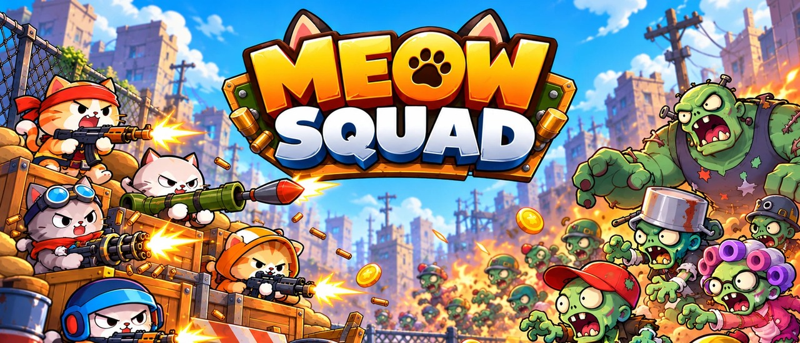

  

<h1 align="center">Meow Squad: Zombie Defense</h1>

  <b>Merge cats. Hold the barricade. Stop the horde.</b> 
  A merge + tower defense game for your browser: combine cats into stronger fighters and keep the zombies off the street.

  

  <a href="https://playgama.com/game/meow-squad-zombie-defense"><b>playgama.com/game/meow-squad-zombie-defense</b></a> 
  Free, no download, no sign-up. Plays on desktop and mobile, in landscape or portrait.

---

## Trailer

  
   
  Click the image to watch the trailer.

  🎬 <a href="media/trailer-landscape-1920x1080.mp4"><b>Trailer (landscape, 1920×1080)</b></a>
  &nbsp;•&nbsp;
  📱 <a href="media/trailer-portrait-1080x1620.mp4"><b>Trailer (portrait, 1080×1620)</b></a>

---

## What's in the game

- **Merge to power up**: drag a cat onto an identical cat to merge them into a stronger one, from tiny rookies with blasters to **15 tiers** of legends with rocket launchers.
- **Hold the barricade**: cats on the barricade shoot by themselves, while you merge, recruit, repair the wall and **tap zombies to bonk them**.
- **60-level campaign** across five areas (Downtown Street, Dusty Junkyard, Rail Yard, Night Highway, Green Park), with **7 bosses** to beat.
- **Power-up cards** between waves: lightning storms, meteor showers, Frost Nova and more, roguelite style.
- **Add-ons** for when the horde gets close: TNT, Spike Traps, Rapid Fire and a freezing Time Bomb.
- **Endless mode** and a **Daily Challenge** with a new twist every day.
- **Upgrades** between battles: firepower, recruit level, barricade and coin bonus.
- **Chests, daily gifts, missions, the Cat Pass**, a zombie collection with bounties, and **Rebirth** with Golden Catnip for long-term players.
- Your cats keep guarding the street while you're away and earn **offline coins**.

---

## How to play

| Action | Mouse / touch |
|---|---|
| Merge two cats | Drag one cat onto an identical cat |
| Put a cat on the barricade | Drag it onto a barricade box |
| Bonk a zombie | Tap or click it |
| Buy a cat / repair the wall | **Recruit** / **Repair** buttons |
| Use an add-on | Tap its button when zombies crowd in |

New players get a short guided tutorial in the first battle.

---

## Images

  

  
  
  

  
  

---

## Press kit

Every cover, thumbnail and trailer used on the game portals is in [`media/`](media):

- [`media/images/`](media/images): covers (1920×1080, 1080×1920, 800×1200, 800×800)
- [`media/press-kit/`](media/press-kit): portal images (1280×720, 1280×550, 512×512, 512×384, 200×120)
- Trailers: [landscape](media/trailer-landscape-1920x1080.mp4) and [portrait](media/trailer-portrait-1080x1620.mp4)

---

## Built with

- **Phaser 3**, **TypeScript** and **Vite** (HTML5, runs in any modern browser)
- **Playgama Bridge** SDK for the web release

### Credits

- Game art: [CraftPix](https://craftpix.net) "Cartoon Cat Defense Game Asset Kit"
- Sound effects and music: [Kenney](https://kenney.nl) and [OpenGameArt](https://opengameart.org) (CC0)
- Font: Passion One (SIL Open Font License)

---

  <a href="https://playgama.com/game/meow-squad-zombie-defense"><b>▶ Play Meow Squad on Playgama</b></a>
    
  © Meow Squad: Zombie Defense. All rights reserved. This repository is the game's public page; the source code is private.

